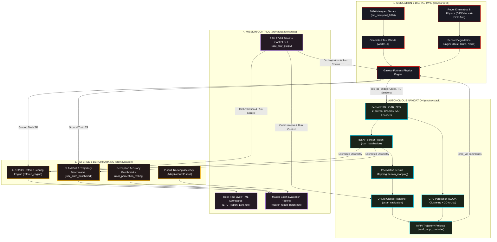
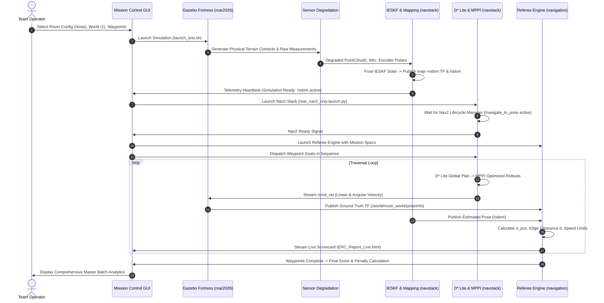
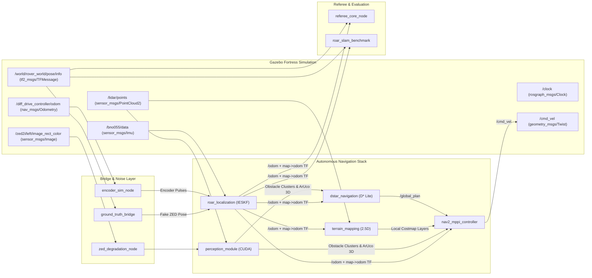
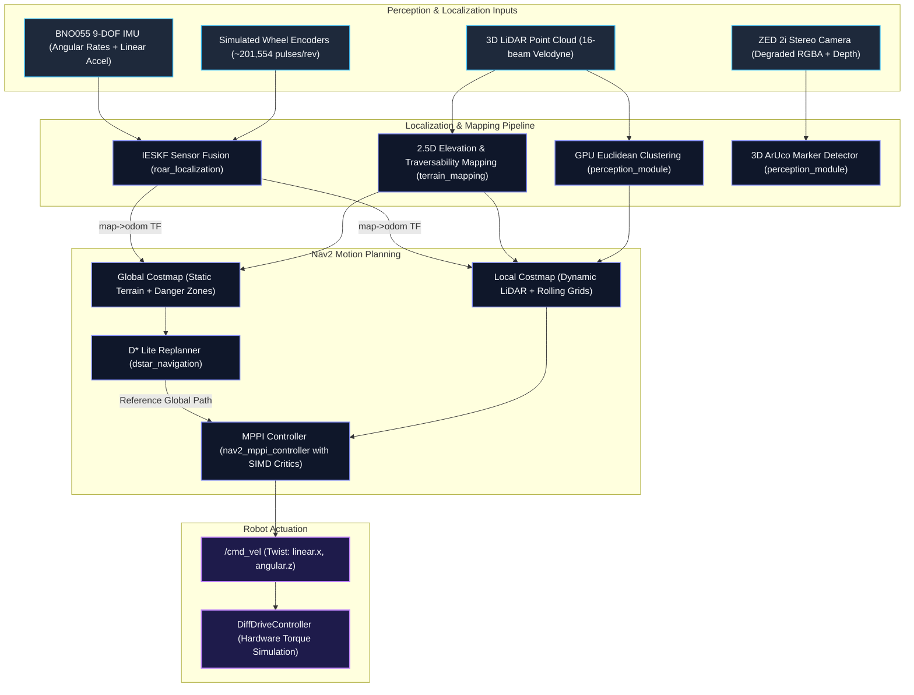

# 🛰️ ASU ROAR 2026 — End-to-End Autonomous Rover Pipeline Architecture

[](https://docs.ros.org/en/humble/)
[](https://gazebosim.org/home)
[](https://roverchallenge.eu/)
[](../)

Welcome to the central technical documentation for the **ASU ROAR 2026 Autonomous Rover System**. This guide provides an end-to-end visual and architectural overview of our software stack, simulation environment, and autonomous navigation pipeline developed for the **European Rover Challenge (ERC) 2026**.

## Quick Start — Run From Any Location

The project does not require a specific username, parent directory, or workspace
name. After cloning or downloading it, enter its `src` directory and run the
portable launcher:

```bash
cd ROAR-26-Simulation/src
./start_gui.sh
```

For example, the project can be stored in any location:

```bash
cd ~/Downloads/ROAR-26-Simulation/src
./start_gui.sh
```

On the first run, `start_gui.sh` automatically detects the workspace root,
sets `ROAR_WS`, sources ROS 2 Humble, builds the workspace, sources the built
overlay, and launches the Mission Control GUI. Later runs reuse the existing
build and start the GUI directly.

### Requirements

- Ubuntu with ROS 2 Humble installed under `/opt/ros/humble`
- The project dependencies required by its ROS packages
- An available graphical display for the Mission Control GUI

## Using the Mission Control GUI

For a safe first run, use World 1, waypoint 0, one iteration, and the
**Noise Free** rover.

1. Open **01 — PREVIEW**.
   - Set `WORLD` to `1`.
   - Set `WP INDEX` to `0`.
   - Click **RENDER MAP** and confirm the terrain and route appear.

2. Open **02 — EVALUATION**.
   - Keep **SLAM EVALUATION ENABLED** selected.
   - Leave Perception and Pure Pursuit evaluation disabled for the first run.

3. Open **03 — MISSION SETUP**.
   - Set `FROM WORLD` and `TO WORLD` to `1`.
   - Set `FROM WP` and `TO WP` to `0`.
   - Set `ITERATIONS` to `1`.
   - Click **ADD TO BATCH QUEUE**.

4. Open **04 — LAUNCH**.
   - Select **Noise Free** under `ROVER CONFIG`.
   - Optionally select **Open RViz2**.
   - Click **RUN BATCH PIPELINE**.

5. Watch **RUN STATUS MONITOR** while the GUI starts the pipeline:

   ```text
   Gazebo → Nav2/SLAM → Referee → Waypoint follower → Reports
   ```

6. After completion, open **05 — REPORTS** to view the master evaluation and
   subsystem reports.

### Stopping the System

- Use **CLEAR & RESET BATCH (KILL NODES)** to cancel a batch and clear its queue.
- Use **TERMINATE ALL** to stop manually launched simulation and navigation processes.
- Use **SKIP CURRENT TEST** to skip only the active batch item.

### Manual Launch Mode

In **04 — LAUNCH**, use the manual buttons in this order:

1. Click **1. LAUNCH SIM**.
2. Wait for **SIMULATION READY**.
3. Click **2. LAUNCH NAV2** and wait for Nav2 to become active.
4. Click **3. SEND WPTS**.
5. Click **TERMINATE ALL** when finished.

---

## 📑 Table of Contents
1. [Executive Summary & System Workflow](#-executive-summary--system-workflow)
2. [End-to-End Dataflow & Pipeline Architecture](#-end-to-end-dataflow--pipeline-architecture)
3. [ROS 2 Computational Graph & Topic Wiring](#-ros-2-computational-graph--topic-wiring)
4. [Coordinate Reference Frames & Transformation Bridge](#-coordinate-reference-frames--transformation-bridge)
5. [Autonomous Navigation Stack Breakdown](#-autonomous-navigation-stack-breakdown)
6. [Automated Referee & Evaluation Pipeline](#-automated-referee--evaluation-pipeline)
7. [Module Breakdown & Package Inventory](#-module-breakdown--package-inventory)

---

## 🌐 Executive Summary & System Workflow

The ROAR 2026 system is composed of three interconnected modules hosted inside a single, unified ROS 2 Humble workspace:

```text
${ROAR_WS}/src/
├── roar2026/       --> Physics Engine, Digital Twin, Rover Models & Environment Generation
├── navigation/     --> Mission Control Dashboard, Benchmark Suites & ERC Referee Engine
└── navstack/       --> Autonomous Navigation (Global D* Lite, Local MPPI, SLAM, GPU Perception)
```

### High-Level System Workflow


---

## 🔄 End-to-End Dataflow & Pipeline Architecture

The entire progression from raw photogrammetry survey meshes down to real-time waypoint execution and referee reporting operates through the following deterministic pipeline:



---

## 🔌 ROS 2 Computational Graph & Topic Wiring

The table below documents the core topic contracts bridging simulation, navigation, and referee scoring:



---

## 📐 Coordinate Reference Frames & Transformation Bridge

One of the most critical aspects of the European Rover Challenge is handling discrepancies between the **Official Survey Reference Frame** and the **Gazebo Simulation Frame**:

### Coordinate System Transformation
```text
Official ERC Survey Frame                     Gazebo Fortress Frame
           +Y                                          +X
           ▲                                           ▲
           │                                           │
           │                                           │
  -X ◄─────┼─────► +X                 -Y ◄─────────────┼─────────────► +Y
           │                                           │
           │                                           │
           ▼ -Y                                        ▼ -Z
```

$$\begin{aligned}
X_{\text{gazebo}} &= X_{\text{reference}} \\
Y_{\text{gazebo}} &= -Y_{\text{reference}} \\
Z_{\text{gazebo}} &= Z_{\text{reference}}
\end{aligned}$$

- **`src/roar2026/coordinate_bridge`** provides a centralized, tested Python API (`survey_to_world()` / `world_to_survey()`) to guarantee that all metric coordinates (waypoints, obstacles, ArUco positions) are seamlessly mapped without manual negation bugs.

---

## 🚗 Autonomous Navigation Stack Breakdown



---

## ⚖️ Automated Referee & Evaluation Pipeline

The **`referee_engine`** executes official ERC rules to score rover navigation in real time:

$$\text{Final Score} = \sum_{i=1}^{N_{\text{legs}}} \text{Points}_i - \text{Penalties}$$

### Scoring Rules Breakdown:
1. **Positional Error Deduction**:
   $$e_{\text{pos}} = \|\mathbf{p}_{\text{rover}} - \mathbf{p}_{\text{wp}}\|_2$$
   - $e_{\text{pos}} \le 0.5\,\text{m}$: Full 100% leg score.
   - $0.5\,\text{m} < e_{\text{pos}} \le 2.0\,\text{m}$: Linear score degradation down to 20%.
   - $e_{\text{pos}} > 2.0\,\text{m}$: 0 points for leg.
2. **Speed & Time Budget**:
   - Computes $T_{\text{min}}$ (from max velocity $v_{\text{max}} = 0.8\,\text{m/s}$) and $T_{\text{max}}$ (from min velocity $v_{\text{min}} = 0.15\,\text{m/s}$).
   - Time exceeding $T_{\text{max}}$ applies continuous point decay; hard stop at 20 minutes (ERC regulation).
3. **Collision & Safety Penalties**:
   - Severe penalty ($-50$ pts) for rock collisions or leaving survey boundaries.

---

## 📁 Module Breakdown & Package Inventory

The monorepo contains **29 ROS 2 packages** structured into three clean source directories:

```text
${ROAR_WS}/src/
│
├── roar2026/                         # [Module 1: Simulation & Digital Twin]
│   ├── coordinate_bridge/            # Metric frame transform bridge
│   ├── dev_environment/             # Rover models (clean, noise, full) & test worlds 1..3
│   ├── marsyards/                    # erc_marsyard_2026 terrain model & ArUco 1..15 models
│   ├── navMission_setup/             # World & waypoint automated generation pipelines
│   └── panel/                        # ERC maintenance panel & 12 component controller packages
│
├── navigation/                       # [Module 2: Mission Control & Evaluation]
│   ├── bench_marking/                # Evaluators: AdaptivePurePursuit, roar_perception_testing, roar_slam_benchmark
│   ├── missions/                     # Mission assets & waypoint arrays for Worlds 1..3
│   ├── referee_engine/               # ERC automated scoring rules engine
│   └── scripts/                      # Mission Control GUI (asu_roar_gui.py) & preview_mission.py
│
└── navstack/                         # [Module 3: Autonomous Navigation Stack]
    ├── control/                      # nav2_mppi_controller (with bundled SIMD local_deps)
    ├── navstack_nav2/                # Nav2 orchestration, costmaps, and behavior tree configs
    ├── path-planning/                # dstar_navigation (D* Lite global replanner)
    ├── perception/                   # perception_module (GPU LiDAR clustering & 3D ArUco detection)
    └── slam/                         # roar_localization (IESKF), terrain_mapping, roar_slam_testing
```

---

## 📖 Sub-Module Technical Documentation

For in-depth documentation on individual modules and sub-systems, refer to their dedicated README guides:

| Module / Subsystem | Path | Description |
| :--- | :--- | :--- |
| **Simulation Core** | [`src/roar2026/README.md`](file://${ROAR_WS}/src/roar2026/README.md) | Physics engine, sensor degradation models, and Gazebo fortress configs |
| **Dev Environment** | [`src/roar2026/dev_environment/README.md`](file://${ROAR_WS}/src/roar2026/dev_environment/README.md) | CLI launch runner `launch_test.sh` and multi-world testing guide |
| **Marsyard & Models** | [`src/roar2026/marsyards/README.md`](file://${ROAR_WS}/src/roar2026/marsyards/README.md) | 2026 terrain mesh specifications, collision optimization, and ArUco tags |
| **World & Waypoint Pipeline** | [`src/roar2026/navMission_setup/README.md`](file://${ROAR_WS}/src/roar2026/navMission_setup/README.md) | Heightmap, costmap, and waypoint synthesis automation |
| **Maintenance Panel** | [`src/roar2026/panel/README.md`](file://${ROAR_WS}/src/roar2026/panel/README.md) | Maintenance panel URDFs, joints, switch controllers, and Gazebo interfaces |
| **Coordinate Bridge** | [`src/roar2026/coordinate_bridge/README.md`](file://${ROAR_WS}/src/roar2026/coordinate_bridge/README.md) | Reference frame vs Gazebo coordinate transformation API |
| **Navigation & GUI** | [`src/navigation/README.md`](file://${ROAR_WS}/src/navigation/README.md) | Mission Control GUI dashboard, scoring rules, and batch evaluation |
| **Referee Engine** | [`src/navigation/referee_engine/README.md`](file://${ROAR_WS}/src/navigation/referee_engine/README.md) | Official ERC rules engine, time budgets, and live scorecards |
| **Benchmarking Suite** | [`src/navigation/bench_marking/README.md`](file://${ROAR_WS}/src/navigation/bench_marking/README.md) | SLAM trajectory error (APE/RPE), perception accuracy, and pursuit benchmarks |
| **Mission Datasets** | [`src/navigation/missions/README.md`](file://${ROAR_WS}/src/navigation/missions/README.md) | Waypoints formats, obstacle datasets, and ground truth assets |
| **Autonomous NavStack** | [`src/navstack/README.md`](file://${ROAR_WS}/src/navstack/README.md) | Nav2 stack bringup, behavior trees, and navigation lifecycle |
| **MPPI Controller** | [`src/navstack/control/README.md`](file://${ROAR_WS}/src/navstack/control/README.md) | Local trajectory rollouts, SIMD critics, and dynamic parameter tuning |
| **D* Lite Global Planner** | [`src/navstack/path-planning/README.md`](file://${ROAR_WS}/src/navstack/path-planning/README.md) | Incremental graph search on 2.5D costmaps and obstacle avoidance |
| **GPU Perception** | [`src/navstack/perception/README.md`](file://${ROAR_WS}/src/navstack/perception/README.md) | CUDA Euclidean point-cloud clustering and 3D ArUco visual localization |
| **IESKF & SLAM** | [`src/navstack/slam/README.md`](file://${ROAR_WS}/src/navstack/slam/README.md) | Multi-sensor Kalman filtering, encoder odometry, and elevation mapping |
