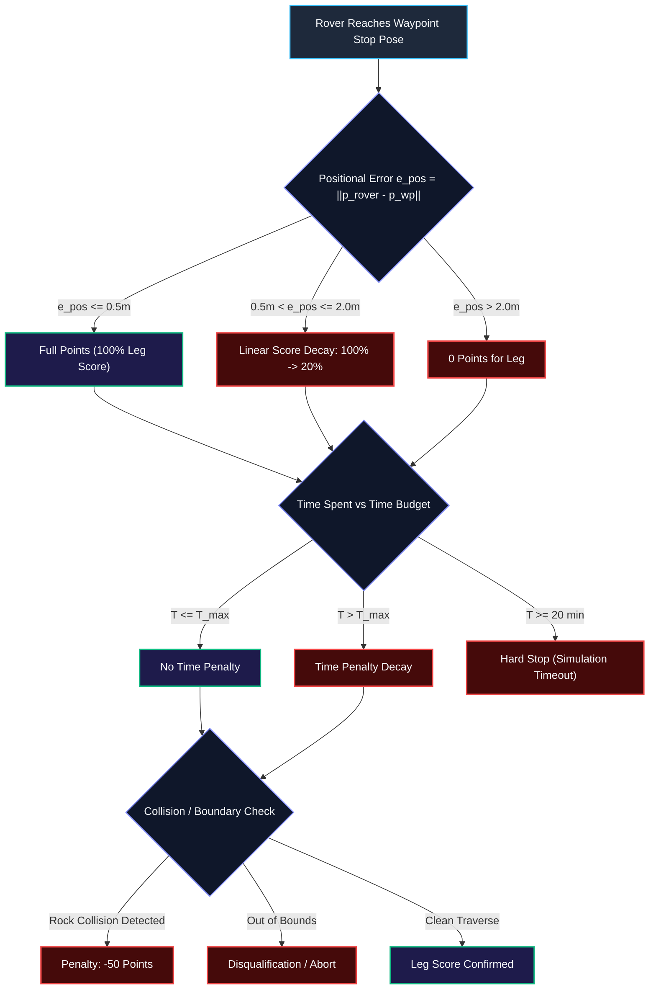

# ⚖️ ROAR 2026 — Automated ERC Referee Scoring Engine

The `referee_engine` package implements an automated, deterministic scoring evaluator adhering strictly to the official **European Rover Challenge Navigation Task Rules** (Traverse Sub-Task: Maximum 300 Points).

---

## 📊 Scoring System Formulation

---

## 🧮 Mathematical Scoring Rules

### 1. Positional Error ($e_{\text{pos}}$)
$$\text{Error} = \|\mathbf{p}_{\text{rover}} - \mathbf{p}_{\text{target}}\|_2 = \sqrt{(x_{\text{rover}} - x_{\text{wp}})^2 + (y_{\text{rover}} - y_{\text{wp}})^2}$$

- **Target Radius**: $r_{\text{inner}} = 0.5\,\text{m}$ (Maximum Points).
- **Tolerance Radius**: $r_{\text{outer}} = 2.0\,\text{m}$.
- Points for leg $i$:
$$\text{Score}_i = \begin{cases} 
S_{\text{base}} & \text{if } e_{\text{pos}} \le 0.5 \\
S_{\text{base}} \cdot \left(1.0 - 0.8 \cdot \frac{e_{\text{pos}} - 0.5}{1.5}\right) & \text{if } 0.5 < e_{\text{pos}} \le 2.0 \\
0 & \text{if } e_{\text{pos}} > 2.0
\end{cases}$$

### 2. Time Budget & Speed Caps
- Path length of leg: $L_i$.
- Minimum speed: $v_{\text{min}} = 0.15\,\text{m/s} \implies T_{\text{max}} = \frac{L_i}{v_{\text{min}}}$.
- Maximum speed: $v_{\text{max}} = 0.80\,\text{m/s} \implies T_{\text{min}} = \frac{L_i}{v_{\text{max}}}$.
- Hard Competition Time Cap: **20 minutes (1200 seconds)**.

---

## 📄 Live Outputs & Scorecards

- **Real-Time HTML Scorecard**: `reports/referee/ERC_Report_Live.html`  
  Continuously auto-refreshes during live runs to display leg-by-leg breakdowns, trajectory plots, and current accumulated points.
- **Structured Data Summary**: `reports/referee/run_summary.npy`  
  Stores terminal status (`SUCCESS`, `COLLISION`, `TIMEOUT`), point breakdown, execution times, and trajectory coordinates for batch aggregation.
