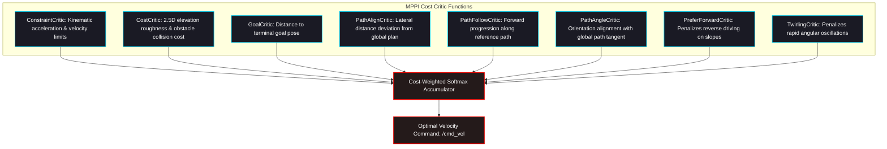

# 🎮 ROAR 2026 — Model Predictive Path Integral (MPPI) Local Controller

The `nav2_mppi_controller` package provides high-frequency local trajectory optimization for differential-drive navigation over rough Martian terrain. It samples thousands of potential control sequences in parallel, scores them using mathematical cost critics, and computes the optimal control command.

---

## 🧮 MPPI Mathematical Formulation

At each control cycle ($\Delta t = 0.05\,\text{s}$ / $20\,\text{Hz}$), MPPI perturbs a nominal control sequence with Gaussian noise:

$$\mathbf{u}_t^{(k)} = \mathbf{v}_t + \boldsymbol{\epsilon}_t^{(k)}, \quad \boldsymbol{\epsilon}_t^{(k)} \sim \mathcal{N}(\mathbf{0}, \boldsymbol{\Sigma})$$

Each candidate trajectory is projected forward across the prediction horizon ($T = 56$ steps, $2.8\,\text{seconds}$) and evaluated using the total trajectory cost:

$$S\left(\tau^{(k)}\right) = \phi\left(\mathbf{x}_T^{(k)}\right) + \sum_{t=0}^{T-1} \left[ q\left(\mathbf{x}_t^{(k)}\right) + \lambda \mathbf{v}_t^T \boldsymbol{\Sigma}^{-1} \boldsymbol{\epsilon}_t^{(k)} \right]$$

The optimal control update is the cost-weighted expectation:

$$\mathbf{u}_t^* = \mathbf{v}_t + \sum_{k=1}^K w_k \boldsymbol{\epsilon}_t^{(k)}, \quad w_k = \frac{\exp\left(-\frac{1}{\lambda} S(\tau^{(k)})\right)}{\sum_{j=1}^K \exp\left(-\frac{1}{\lambda} S(\tau^{(j)})\right)}$$

---

## ⚖️ Cost Critics Architecture

---

## ⚡ Bundled SIMD Hardware Acceleration (`local_deps`)

To achieve $20\,\text{Hz}$ real-time control rollouts without dedicated GPU dependencies:
- **`xsimd`**: C++ wrapper for portable SIMD intrinsics (AVX2, FMA, SSE4.2).
- **`xtensor`**: Multi-dimensional tensor expressions evaluating thousands of trajectory candidates concurrently on CPU SIMD vector registers.
- Pre-compiled and bundled inside `src/navstack/local_deps` for zero-install portability.
