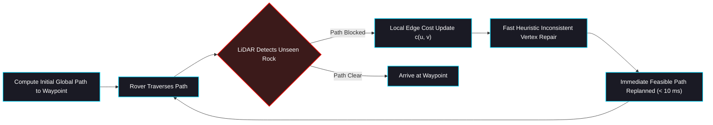

# 🗺️ ROAR 2026 — D* Lite Global Path Planner

[](file://${ROAR_WS}/src/navstack/path-planning/globalPlanner)
[](https://www.cs.cmu.edu/~maxim/files/dlite_aaai02.pdf)

The `dstar_navigation` package provides dynamic global path planning across the 2.5D Marsyard terrain. It implements the **D* Lite** algorithm (Koenig & Likhachev), enabling rapid replanning from scratch whenever the rover's on-board LiDAR detects new or moving obstacles.

---

## 🧭 Why D* Lite for Martian Navigation?

Unlike static planners (A* or Dijkstra), which must recompute the entire path from scratch when an unexpected obstacle is discovered, **D* Lite** operates backwards from the goal and repairs only the affected search graph nodes:



---

## 📁 Directory Structure

```text
src/navstack/path-planning/globalPlanner/
├── CMakeLists.txt                    # C++ build configuration
├── package.xml                       # ROS 2 Humble package definition
├── include/
│   ├── dstar_lite.h                  # Core C++ D* Lite graph search implementation
│   └── grid_map.h                    # 2D/2.5D grid map representation
├── src/
│   ├── dstar_node.cpp                # ROS 2 node interfacing with /global_plan
│   └── dstar_lite.cpp                # Algorithmic priority queue operations
├── config/
│   └── config.yaml                   # Grid resolution, inflation radius & heuristic weights
├── scripts/
│   ├── erc_waypoint_follower.py      # Interactive waypoint follower dispatching goals to Nav2
│   └── batch_waypoint_follower.py    # Headless batch test runner for automated evaluations
└── offline_tools/
    └── run_pipeline.sh               # Standalone heightmap-to-plan generation pipeline
```

---

## ⚡ ROS 2 Node Interface

- **Subscribes**:
  - `/map` (`nav_msgs/OccupancyGrid`): Active static and dynamic costmap layers.
  - `/initialpose` (`geometry_msgs/PoseWithCovarianceStamped`): Current rover localization.
  - `/goal_pose` (`geometry_msgs/PoseStamped`): Waypoint target pose.
- **Publishes**:
  - `/global_plan` (`nav_msgs/Path`): Collision-free trajectory delivered to the MPPI local controller.

