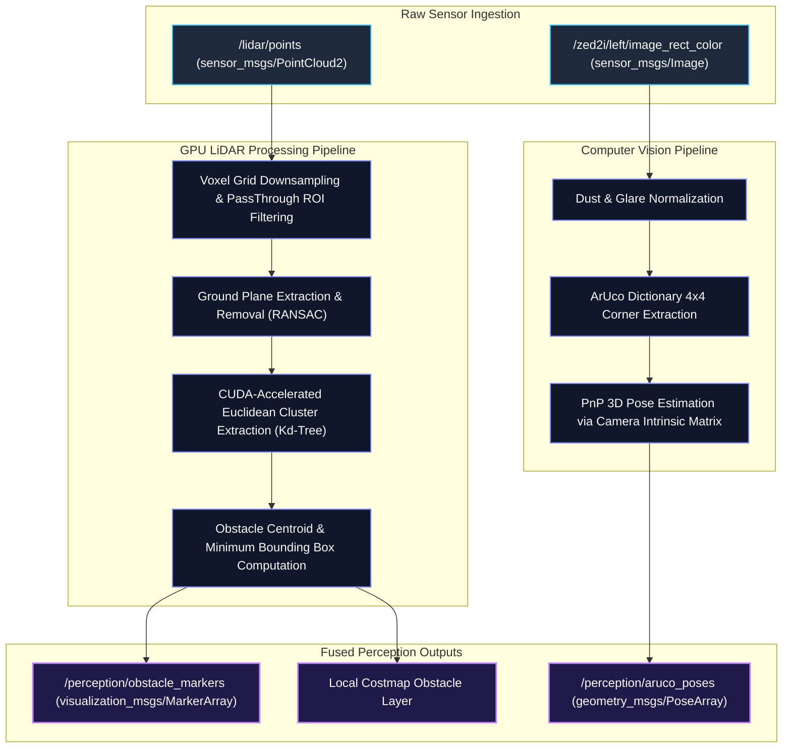

# 👁️ ROAR 2026 — GPU LiDAR Perception & 3D ArUco Detection

The `perception_module` package processes real-time sensor streams from the **16-beam 3D LiDAR** and the **ZED 2i Stereo Camera** to extract 3D obstacle bounding boxes and calculate 6-DOF poses of competition ArUco navigation markers.

---

## 🏗️ Perception Pipeline Architecture

---

## ⚡ Performance Specifications

- **LiDAR Processing Rate**: $\ge 15\,\text{Hz}$ with CUDA acceleration.
- **Minimum Detectable Rock Radius**: $0.15\,\text{m}$.
- **Maximum Detection Range**: $15.0\,\text{m}$ forward swath.
- **ArUco 3D Localization Accuracy**: $\pm 0.03\,\text{m}$ at $3.0\,\text{m}$ distance.
