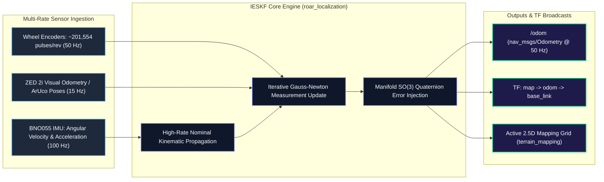

# 🧭 ROAR 2026 — SLAM, IESKF Localization & Active Mapping

[](file://${ROAR_WS}/src/navstack)
[](file://${ROAR_WS}/src/navstack/slam/roar_localization)

This subsystem provides robust state estimation and real-time 2.5D elevation mapping for the ROAR rover over rough Martian terrain where GPS is unavailable.

---

## 🧮 Iterated Error-State Kalman Filter (IESKF) Architecture

The `roar_localization` package executes an **IESKF** algorithm that decouples nominal kinematic integration from error-state estimation:

$$\mathbf{x} = \begin{bmatrix} \mathbf{p}^T & \mathbf{v}^T & \mathbf{q}^T & \mathbf{b}_a^T & \mathbf{b}_g^T \end{bmatrix}^T \in \mathbb{R}^{16}$$



---

## 📦 Sub-Packages Breakdown

```text
src/navstack/slam/
├── active_mapping_msgs/      # Custom ROS 2 IDL messages for elevation matrices
├── roar_msgs/                # Custom telemetry, covariance & benchmark message types
├── roar_localization/        # Production IESKF multi-sensor fusion node (ieskf_node.py)
├── roar_slam_testing/        # Real-time SLAM diagnostic evaluator & trajectory visualizer
└── terrain_mapping/          # Online 2.5D elevation and slope roughness map generator
```

---

## 🗺️ 2.5D Active Terrain Mapping (`terrain_mapping`)

As the rover traverses the terrain, `terrain_mapping` continuously integrates incoming LiDAR point clouds into a rolling 2.5D elevation grid:
- **Cell Resolution**: $0.10\,\text{m} \times 0.10\,\text{m}$.
- **Grid Features**:
  - Mean elevation $z_{\text{mean}}$.
  - Local surface variance (roughness $\sigma_z^2$).
  - Surface normal angle $\theta_{\text{slope}} = \arccos(\mathbf{n} \cdot \mathbf{k})$.
- **Costmap Integration**: Automatically published to Nav2 costmap layers to steer the local planner away from steep crater slopes.
