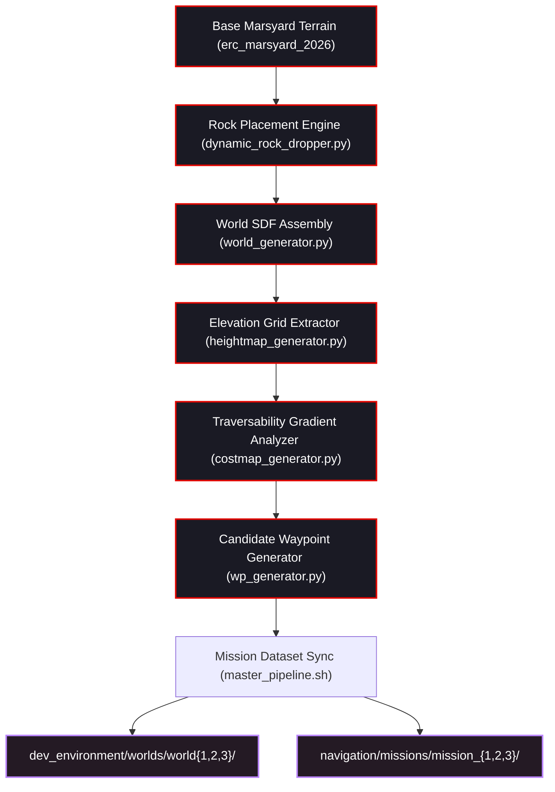

# 🏗️ ROAR 2026 — World & Waypoint Synthesis Pipeline

[](file:///home/draaven/ROAR_2026/src/roar2026)
[](file:///home/draaven/ROAR_2026/src/roar2026/navMission_setup/master_pipeline.sh)

The `navMission_setup` subsystem provides an automated, mathematically rigorous pipeline to generate synthetic Marsyard worlds, compute traversability costmaps, and generate valid navigation waypoint missions for the European Rover Challenge.

---

## 🏛️ Pipeline Flowchart



---

## 📁 Directory Structure

```text
src/roar2026/navMission_setup/
├── build_full_worlds.sh              # Orchestrates world generation across Worlds 1, 2, and 3
├── master_pipeline.sh                # End-to-end automation: builds worlds + syncs waypoints to missions
├── world_setup/
│   ├── world_gen/
│   │   ├── world_generator.py        # Assembles full SDF world with terrain + procedural rocks
│   │   ├── dynamic_rock_dropper.py   # Raycasts rocks onto terrain surface without mesh penetration
│   │   └── create_aruco_models.py    # Generates SDF models for ArUco pedestals
│   ├── heightMap_gen/
│   │   └── heightmap_generator.py    # Samples OBJ terrain collision mesh into 0.25m grid (heightmap.npz)
│   └── costMap_gen/
│       └── costmap_generator.py      # Computes slope gradient, roughness & binary inflation (costmap.npz)
│
└── waypoints_setup/
    └── wayPoint_generator/
        ├── wp_generator.py           # Generates traversable waypoint paths avoiding rock hazards
        └── inputs/                   # Staging inputs (heightmap.npz, obstacle_data.npy)
```

---

## ⚡ Running the Automation Pipeline

### Single-Command World & Mission Regeneration
To rebuild all three competition worlds and synchronize waypoints to `src/navigation/missions`:

```bash
cd ~/ROAR_2026
source /opt/ros/humble/setup.bash
source install/setup.bash

cd src/roar2026/navMission_setup
bash master_pipeline.sh
```

### Outputs Produced:
1. **Simulation World (`world{1,2,3}.world`)**: Generated in `src/roar2026/dev_environment/worlds/`.
2. **Heightmap (`heightmap.npz`)**: 2D elevation grid with resolution ($0.25\,\text{m}$) and coordinate origins ($o_x, o_y$).
3. **Traversability Costmap (`costmap.npz`)**: Normalized traversability cost matrix $[0.0, 1.0]$.
4. **Obstacle Ground Truth (`obstacle_data.npy`)**: Array of all placed rocks, positions, and bounding radii.
5. **Waypoint Sequences (`wp00.npy` .. `wp299.npy`)**: Synced to `src/navigation/missions/mission_{1,2,3}/waypoints/`.
